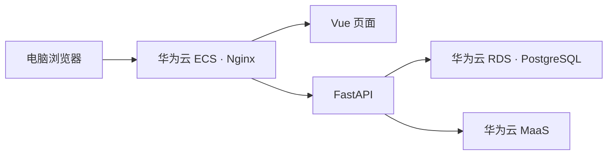

# AI 健康饮食管理系统

面向**电脑端 Web** 的健康饮食管理系统，拟用于华为 ICT 大赛创新赛赛题 1「基于华为云产品打造 AI 创新应用」。以大学生的校园用餐为首个场景，用户可以直接和 AI 助手商量吃什么、按预算换菜、确认打卡，再查看近一周记录或分享餐单。

**当前进度** · 项目初始化。本仓库现阶段提供项目说明和开发约定，应用代码、可运行 Demo 和云部署属于后续里程碑。

## 产品功能

| 模块 | 首版交付 |
| --- | --- |
| 个人档案 | 登录后管理昵称、口味、预算和忌口，可选记录体重。公开昵称和私人档案分别管理。 |
| AI 饮食推荐 | 在首页聊天，按预算、用餐地点和偏好推荐餐单。支持追问、替换一道菜、查看营养估算和保存方案。 |
| 日常打卡 | 一键带入推荐餐单，或用自然语言描述实际吃了什么。系统生成草稿，用户能修正份量，确认后入库。 |
| 健康数据统计 | 按已确认的饮食记录计算近 7 天能量、蛋白质、打卡天数及可选体重趋势。缺少记录的日期显示「未记录」。 |
| 社区分享 | 将一餐生成分享卡并预览，确认后发布。提供时间线、点赞、举报和管理员下架。 |

桌面首页左侧提供模块导航，中间是对话区，右侧展示当前餐单。用户可以边聊边比较方案，也能直接在餐单上换菜、保存或发起打卡。

## 用一段对话演示

1. 用户说「今晚在学校吃，20 元以内，想清淡一点」。助手结合档案中的忌口查菜，给出候选组合。
2. 用户说「第一套的鸡肉换掉，预算不变」。助手保留本轮预算、地点和忌口，只换主菜，重新核算。
3. 用户说「我只吃了半份米饭，帮我记一下」。助手生成打卡草稿，用户确认后，周报随即更新。
4. 用户可以把这餐生成分享卡。分享预览仅展示选中的餐食与短文，发布前由用户确认。

## 技术栈

| 层 | 选型 |
| --- | --- |
| 前端 | Vue 3、TypeScript、Vite、Element Plus、ECharts |
| 后端 | Python、FastAPI、Pydantic、SQLAlchemy、Alembic |
| 数据库 | PostgreSQL。本地用 Docker Compose，云上用华为云 RDS for PostgreSQL。 |
| 模型 | 华为云 MaaS。首测 DeepSeek-V4.1-Flash-1017，模型 ID 与超时从服务端配置读取。 |
| 开发与发布 | VS Code + 华为云码道 CodeArts 代码智能体，拟用 CodeArts Deploy 部署到 ECS。 |



计划让 Nginx 同域提供网页和 `/api`，由 FastAPI 通过内网访问 RDS。应用端密钥通过服务端环境变量配置。码道用于项目生成、调试、测试和部署，团队在开发过程中保留实际使用记录。

## AI 助手设计

前端调用 `POST /api/assistant/chat`。模型决定是否追问、查哪些菜、怎么搭配。FastAPI 校验并执行预定义工具，返回聊天文本、已核算的餐单卡片和待确认操作。

| 工具 | 输入和结果 |
| --- | --- |
| `get_diet_context` | 以当前登录账号为准，读取本轮需要的档案偏好、当天已确认记录和当前会话餐单。 |
| `search_dishes` | 接收预算、地点、口味和要排除的食材，返回食物库中的菜品 ID、份量选项、价格和来源。 |
| `validate_meal` | 按菜品 ID 和份量重算营养估算与价格，复核预算和忌口后才生成餐单卡片。 |

- **会话和档案** · 临时预算、地点和换菜要求在当前会话内沿用。长期偏好由用户明确保存。会话和档案按账号隔离。
- **数据来源** · 食材和份量有据可查，价格和供应缺少数据时显示「未知」。营养由后端计算并标注估算。成分信息不足的菜品不进入相关忌口用户的推荐。
- **确认写入** · 模型用于建议和生成草稿。打卡、更新档案和公开发帖通过各自的确认接口写入。打卡存份量和营养快照，并用幂等键防止重复保存。
- **降级** · 模型超时或输出无法校验时，界面提示可重试并提供手动选菜、手动记录入口。已有统计和记录仍可使用。

## 本地开发与里程碑

拉取初始化仓库并用 VS Code 打开。

```bash
git clone https://github.com/h67661270-wq/ai-diet-manager.git
cd ai-diet-manager
code .
```

计划使用 Git、Node.js 24 LTS、Python 3.13 和 Docker Compose。工程骨架合入后，将在这里补充依赖安装、数据库迁移、样例数据导入、配置变量与启动命令。

| 里程碑 | 完成标准 |
| --- | --- |
| M1 对话饮食推荐 | 有可复现的样例菜库，桌面浏览器能完成自然语言推荐、多轮换菜与确认打卡。 |
| M2 五项功能联通 | 登录后可编辑档案、查看打卡和周报、预览并分享餐单。覆盖预算、忌口、重复提交、隐私和模型失败。 |
| M3 竞赛 Demo | 部署到华为云并提供电脑可访问的地址。队友能依据本地启动说明和部署文档复现。 |

计划目录为 `frontend/`（桌面 Web）、`backend/`（API 和业务规则）、`data/`（有来源的样例菜品和虚构演示数据）和 `deploy/`（容器与云部署配置）。

## 数据和协作约定

- 参赛演示使用虚构账号和档案。模型只接收当前任务需要的信息，分享卡只带出用户预览确认的字段。
- 小份量、配方不详和缺失数据要保留原始状态。食物条目记录数据来源、生熟状态和每 100 克营养值。产品面向日常饮食管理。
- 在功能分支提交，通过 Pull Request 合入 `main`。合并涉及 AI 或统计的功能时，附上一条可复现的输入和预期结果。
- `.env`、API Key 和个人饮食记录仅用于本地或已授权的服务环境。配置示例使用占位值。

## 参考资料

- [华为云 MaaS 工具调用](https://support.huaweicloud.com/model-call-maas/model-call-021.html)
- [华为云码道部署指南](https://support.huaweicloud.com/usermanual-deployman/deployman_hlp_4004.html)
- [中国居民膳食指南](https://dg.cnsoc.org/)
- [USDA FoodData Central 数据下载](https://fdc.nal.usda.gov/download-datasets/)
