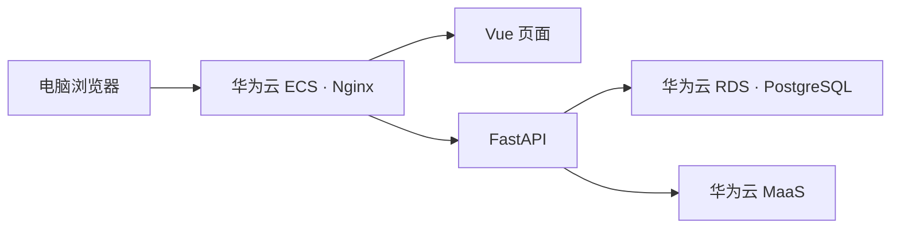

# AI 健康饮食管理系统

面向**电脑端 Web** 的健康饮食管理系统，拟用于华为 ICT 大赛创新赛赛题 1「基于华为云产品打造 AI 创新应用」。以大学生的校园用餐为首个场景，用户可以直接和 AI 助手商量吃什么、按预算换菜、确认打卡，再查看近一周记录或分享餐单。

**当前进度** · 电脑端前端原型已可本地运行。支持示例餐单、打卡、统计、分享和档案。本地状态保存在浏览器，FastAPI、MaaS 和云部署待接入。

## 产品功能

| 模块 | 首版交付 |
| --- | --- |
| 个人档案 | 登录后管理昵称、口味、预算和忌口，可选记录体重。公开昵称和私人档案分别管理。 |
| AI 饮食推荐 | 在首页聊天，由大模型按预算、用餐场景和偏好实时生成餐单。支持追问、换菜和保存方案。 |
| 日常打卡 | 一键带入推荐餐单，或用自然语言描述实际吃了什么。系统生成草稿，用户能修正份量，确认后入库。 |
| 健康数据统计 | 按已确认的饮食记录统计近 7 天打卡天数、具备数值的能量和蛋白质记录，以及可选体重趋势。缺失值显示「未记录」，估算值保留来源标记。 |
| 社区分享 | 将一餐生成分享卡并预览，确认后发布。提供时间线、点赞、举报和管理员下架。 |

桌面首页左侧提供模块导航，中间是对话区，右侧展示当前餐单。用户可以边聊边比较方案，也能直接在餐单上换菜、保存或发起打卡。

## 用一段对话演示

1. 用户说「今晚在学校吃，20 元以内，想清淡一点」。大模型根据对话和用户提供的忌口生成一套餐单，说明搭配思路。食堂实际价格和供应以现场为准。
2. 用户说「鸡肉换成豆腐，预算不变」。大模型沿用本轮预算、地点和忌口，重新生成主菜和搭配说明。
3. 用户说「我只吃了半份米饭，帮我记一下」。助手生成打卡草稿，用户确认后，周报随即更新。
4. 用户可以把这餐生成分享卡。分享预览仅展示选中的餐食与短文，发布前由用户确认。

## 技术栈

| 层 | 选型 |
| --- | --- |
| 前端 | Vue 3、Vite 和原生 CSS。首版使用 CSS 绘制打卡与能量图表。 |
| 后端 | Python、FastAPI、Pydantic、SQLAlchemy、Alembic |
| 数据库 | PostgreSQL 存档案、用户保存的方案、确认打卡和社区内容。本地用 Docker Compose，云上用华为云 RDS for PostgreSQL。 |
| 模型 | 华为云 MaaS。首测 DeepSeek-V4.1-Flash-1017，模型 ID 与超时从服务端配置读取。 |
| 开发与发布 | VS Code + 华为云码道 CodeArts 代码智能体，拟用 CodeArts Deploy 部署到 ECS。 |



计划让 Nginx 同域提供网页和 `/api`，由 FastAPI 通过内网访问 RDS。应用端密钥通过服务端环境变量配置。码道用于项目生成、调试、测试和部署，团队在开发过程中保留实际使用记录。

## AI 助手设计

**用户需求直接发给大模型，餐单按次生成。** 前端通过 `POST /api/assistant/chat` 提交本轮消息和当前会话中相关的上下文。FastAPI 将预算、用餐场景、口味、忌口等必要条件发给华为云 MaaS，由模型决定是否追问，以及推荐哪些菜和怎么搭配。更换菜品时，把上一轮餐单和本轮修改要求一起交给模型。

1. **输入** · 用户的自然语言请求、当前餐单，以及本轮需要的档案偏好。示例为「今晚想吃得清淡，预算 20 元，主菜想吃豆腐」。
2. **输出** · 让模型返回结构化结果，包含 `reply`、可选的 `meal`（菜名、建议份量、已知主要食材、搭配理由）和可选的打卡草稿。追问可以只返回 `reply`。
3. **展示** · FastAPI 用 Pydantic 校验字段和格式，把有效结果返回给前端。界面将模型提供的价格和营养值标为「AI 估算」，缺少依据的字段显示「未知」。涉及忌口时，提醒用户核对实际食材。
4. **存储** · 模型生成的餐单和对话上下文暂存在当前页面会话，用于换菜和追问。用户主动保存方案或确认打卡后，才写入 PostgreSQL。打卡记录保存确认后的菜名、份量和可选营养数值，记录数值来源，并用幂等键防止重复提交。

模型超时或响应无法解析时，提供重新生成和手动录入。周报使用已确认的打卡记录，并在图表上区分 AI 估算和用户填写的数值。

## 本地开发与里程碑

使用 Git 和 Node.js 24 LTS。在 Windows 的 VS Code PowerShell 终端运行下面的命令。

```powershell
git clone https://github.com/h67661270-wq/ai-diet-manager.git
cd ai-diet-manager/frontend
npm.cmd ci
npm.cmd run dev
```

打开终端显示的 `Local` 地址。首页点击「试用示例餐单」可体验保存、打卡与分享。运行 `npm.cmd run build` 可以在 `frontend/dist/` 生成打包后的网页。FastAPI 接口约定和模型模式的配置见 [前端 README](frontend/README.md)。

| 里程碑 | 完成标准 |
| --- | --- |
| M1 对话饮食推荐 | 桌面浏览器能通过 MaaS 完成自然语言推荐、多轮换菜与确认打卡。测试不同预算和忌口下的请求，验证未保存餐单只在当前会话显示。 |
| M2 五项功能联通 | 登录后可编辑档案、查看打卡和周报、预览并分享餐单。覆盖预算、忌口、重复提交、隐私和模型失败。 |
| M3 竞赛 Demo | 部署到华为云并提供电脑可访问的地址。队友能依据本地启动说明和部署文档复现。 |

`frontend/` 存放桌面 Web 源码。后续目录包括 `backend/`（API 和业务规则）、`data/`（虚构演示档案和已确认记录）和 `deploy/`（容器与云部署配置）。

## 数据和协作约定

- 参赛演示使用虚构账号和档案。模型只接收当前任务需要的信息，分享卡只带出用户预览确认的字段。
- 份量不详或缺少营养数据时保留缺失状态。产品面向日常饮食管理，公开演示使用虚构样例。
- 在功能分支提交，通过 Pull Request 合入 `main`。合并涉及 AI 或统计的功能时，附上一条可复现的输入和预期结果。
- `.env`、API Key 和个人饮食记录仅用于本地或已授权的服务环境。配置示例使用占位值。

## 参考资料

- [华为云 MaaS 首次调用指南](https://support.huaweicloud.com/qs-maas/qs-maas-0001.html)
- [华为云码道部署指南](https://support.huaweicloud.com/usermanual-deployman/deployman_hlp_4004.html)
- [中国居民膳食指南](https://dg.cnsoc.org/)
