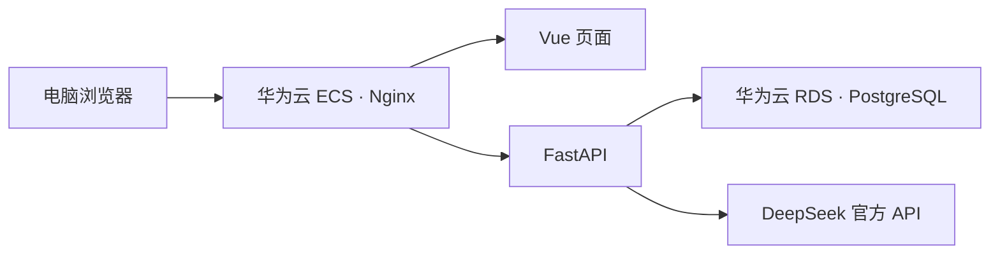

# AI 健康饮食管理系统

面向**电脑端 Web** 的健康饮食管理系统，拟用于华为 ICT 大赛创新赛赛题 1「基于华为云产品打造 AI 创新应用」。以大学生的校园用餐为首个场景，用户可以直接和 AI 助手商量吃什么、按预算换菜、确认打卡，再查看近一周记录或分享餐单。

**当前进度** · 电脑端 Web 原型支持照片打卡、营养统计和图文帖子。配置 DeepSeek 官方 API Key 后可按个人档案生成餐单、对话换菜并分析真实照片。档案和打卡保存在浏览器，共用同一后端的浏览器可看到已发布的社区帖子。

## 产品功能

| 模块 | 首版交付 |
| --- | --- |
| 个人档案 | 登录后管理昵称、口味、预算和忌口，可选记录体重。公开昵称和私人档案分别管理。 |
| AI 饮食推荐 | 在首页聊天，由大模型按预算、用餐场景和偏好实时生成餐单。支持追问、换菜和保存方案。 |
| 日常打卡 | 上传餐食照片，AI 识别食品类别并估算营养，用户确认后保存。 |
| 健康数据统计 | 按已确认打卡汇总近 7 天能量、蛋白质、脂肪和碳水摄入。缺失数值显示「未知」。 |
| 社区分享 | 发图文帖子或从打卡记录带入照片，支持浏览与点赞。 |

桌面首页左侧提供模块导航，中间是对话区，右侧展示当前餐单。用餐后通过「拍照打卡」记录实际吃到的食物。

## 用一段对话演示

1. 用户说「今晚在学校吃，20 元以内，想清淡一点」。大模型根据对话和用户提供的忌口生成一套餐单，说明搭配思路。食堂实际价格和供应以现场为准。
2. 用户说「鸡肉换成豆腐，预算不变」。大模型沿用本轮预算、地点和忌口，重新生成主菜和搭配说明。
3. 用餐后上传照片。模型识别菜品并估算营养，用户确认保存，周报随即更新。
4. 用户从打卡带入配图，填写标题和正文后发布，也可以直接在社区发帖。

## 技术栈

| 层 | 选型 |
| --- | --- |
| 前端 | Vue 3、Vite 和原生 CSS。首版使用 CSS 绘制打卡与能量图表。 |
| 后端 | Python、FastAPI、Pydantic、Pillow。提供饮食推荐、照片分析和社区接口。 |
| 数据 | 社区首版使用 SQLite，浏览器使用 IndexedDB 保存打卡照片。账号与业务数据上云后计划采用 RDS for PostgreSQL。 |
| 模型 | 通过 DeepSeek 官方 API 调用 `deepseek-flash`，支持文本对话和照片分析。 |
| 开发与发布 | VS Code + 华为云码道 CodeArts 代码智能体，拟用 CodeArts Deploy 部署到 ECS。 |



计划让 Nginx 同域提供网页和 `/api`，由 FastAPI 通过内网访问 RDS。应用端密钥通过服务端环境变量配置。码道用于项目生成、调试、测试和部署，团队在开发过程中保留实际使用记录。

## AI 助手设计

**餐单由模型按次生成。** 页面通过 `POST /api/assistant/chat` 提交本轮消息、浏览器保存的档案偏好和最近对话。FastAPI 将预算、用餐场景、口味、忌口组织进系统提示词，由 DeepSeek 决定是否追问，以及推荐哪些菜和怎么搭配。更换菜品时，上一份餐单随请求发送。

1. **输入** · 用户的自然语言请求、当前餐单，以及本轮需要的档案偏好。示例为「今晚想吃得清淡，预算 20 元，主菜想吃豆腐」。
2. **输出** · 模型返回结构化结果，包含 `reply` 和可选的 `meal`（餐单标题、菜名、建议份量和搭配理由）。追问时 `meal` 为空。
3. **展示** · FastAPI 用 Pydantic 校验字段和格式，前端将推荐显示为可保存的卡片。
4. **存储** · 对话和未保存的餐单暂存在当前页面会话，用于换菜和追问。用户主动保存的方案和确认的打卡保存在当前浏览器。

模型超时或响应无法解析时，输入区保留待重试的消息。

## 本地开发与里程碑

使用 Git 和 Node.js 24 LTS。在 Windows 的 VS Code PowerShell 终端运行下面的命令。

```powershell
git clone https://github.com/h67661270-wq/ai-diet-manager.git
cd ai-diet-manager/frontend
npm.cmd ci
npm.cmd run dev
```

打开终端显示的 `Local` 地址。首页点「拍照打卡 → 试用示例照片」可以体验保存、统计和分享。按 [FastAPI 后端说明](backend/README.md) 配置 DeepSeek 密钥并启动服务，即可使用饮食推荐和真实照片分析。运行 `npm.cmd run build` 可在 `frontend/dist/` 生成网页文件。接口约定见 [前端 README](frontend/README.md)。

| 里程碑 | 完成标准 |
| --- | --- |
| M1 对话饮食推荐 | 桌面浏览器能通过 DeepSeek 完成自然语言推荐和多轮换菜。测试不同预算和忌口下的请求，验证未保存餐单只在当前会话显示。 |
| M2 五项功能联通 | 登录后可编辑档案、查看打卡和周报、预览并分享餐单。覆盖预算、忌口、重复提交、隐私和模型失败。 |
| M3 竞赛 Demo | 部署到华为云并提供电脑可访问的地址。队友能依据本地启动说明和部署文档复现。 |

`frontend/` 存放桌面 Web 源码，`backend/` 存放饮食推荐、照片分析和社区接口。

## 数据和协作约定

- 参赛演示使用虚构账号和档案。模型只接收当前任务需要的信息，分享卡只带出用户预览确认的字段。
- 份量不详或缺少营养数据时保留缺失状态。产品面向日常饮食管理，公开演示使用虚构样例。
- 在功能分支提交，通过 Pull Request 合入 `main`。合并涉及 AI 或统计的功能时，附上一条可复现的输入和预期结果。
- `.env`、API Key 和个人饮食记录仅用于本地或已授权的服务环境。配置示例使用占位值。

## 参考资料

- [DeepSeek API 图像理解](https://api-docs.deepseek.com/zh-cn/guides/vision/)
- [华为云码道部署指南](https://support.huaweicloud.com/usermanual-deployman/deployman_hlp_4004.html)
- [中国居民膳食指南](https://dg.cnsoc.org/)
